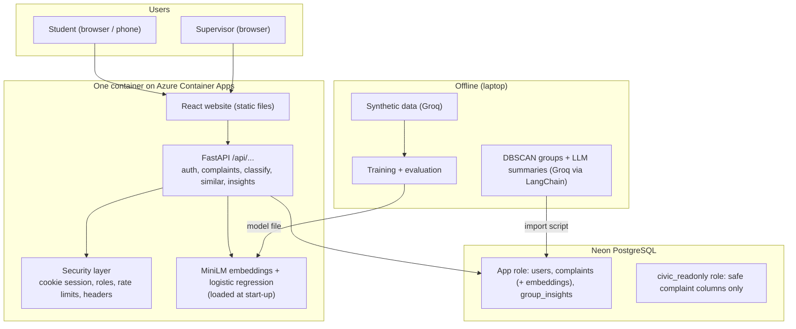

# Architecture

CivicSignal is a **modular monolith**: one FastAPI process serves the API, the built React
website and the AI model. Heavy AI work (data generation, training, clustering, LLM summaries)
runs **offline** on a laptop; its results are imported into the database.

## Overview

## Submitting a complaint

1. The student writes a complaint (English, Hindi or Hinglish), optionally with a location and
   urgency, and submits it. The browser sends the httpOnly session cookie.
2. `POST /api/complaints` validates the input (Pydantic; validation errors never echo the input).
3. The text is encoded **once** with the multilingual MiniLM model (384 numbers); the same vector
   is used to predict the category (logistic regression) and is stored with the complaint for
   later similarity search.
4. If the model's confidence is below 50 %, the complaint is flagged `needs_review`.
5. The complaint is saved with status `Submitted` and the student sees it in their progress
   tracker.

## Supervisor workflow

- **Needs review / All complaints:** filter by category and status, correct the AI's category,
  and move a complaint through allowed status changes only (for example `Assigned -> In Progress
  -> Resolved -> Closed`; `Closed` is final). Invalid jumps are rejected by the server.
- **Repeated problems:** groups of similar complaints with an AI summary, urgency and suggested
  action, read from the `group_insights` table.
- **Similar complaints (API):** cosine similarity over the stored embeddings, supervisor-only.

## Security design

| Concern | Measure |
| :--- | :--- |
| Session theft | JWT in an **httpOnly, SameSite=Lax, Secure** cookie; nothing in localStorage |
| Passwords | bcrypt hashes; "Remember me" = 30-day cookie, otherwise a browser-session cookie |
| Access control | Students see only their own complaints; supervisor-only endpoints for updates, groups and search |
| Brute force | 5 failed logins per email per 15 min, 20 logins per IP per minute, 10 sign-ups per IP per hour (429 + Retry-After) |
| Real client IP | Trusts exactly one proxy hop (`TRUSTED_PROXY_HOPS=1`), so visitors cannot fake their IP |
| Browser attacks | Content-Security-Policy without inline scripts, HSTS, `frame-ancestors 'none'` |
| Bad configuration | The app refuses to start in production with a weak or published JWT secret, default database passwords, or a wildcard / non-https CORS origin |
| Database privilege | `civic_readonly` can read only safe complaint columns (not who reported them, not users); checked in CI by `check_readonly_role.py` |
| Secrets | Never in git or the image: stored as Container Apps secrets; locally in a mode-600 file outside the repo |

## Why one container

- The website and API share one origin, so the login cookie is first-party: no cross-site
  cookie settings and no CORS between site and API.
- Only one proxy sits in front of the app, which keeps client-IP detection for rate limiting
  trustworthy.
- One instance (`max-replicas 1`) keeps in-memory rate limits correct and costs stay inside the
  free allowance; it scales to zero when idle.

See [deployment.md](deployment.md) for hosting details and [DECISIONS.md](DECISIONS.md) for the
reasoning behind the main choices.
