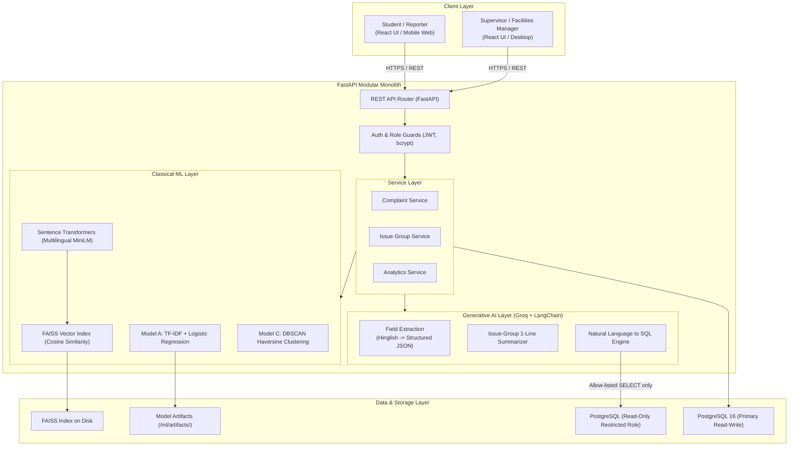

# CivicSignal System Architecture

CivicSignal is an AI-powered public complaint intelligence platform built specifically for university campus facility operations (Amity University Lucknow).

---

## 1. High-Level Modular Monolith Diagram

---

## 2. Request Lifecycle for Complaint Submission

1. **Intake**: A student submits a complaint in English, informal Hinglish, or with typos.
2. **Persistence**: The complaint is validated and stored in `complaints` with status `Submitted`.
3. **Structured Extraction**: The raw text is passed to `backend/app/llm/extraction.py` (Groq API via LangChain) to parse `category_hint`, `location_mention`, `urgency`, and `clean_summary_en`. If Groq is down or times out, the system safely falls back to classical classification.
4. **Classification**: `backend/app/ml/classifier.py` runs the TF-IDF baseline model to predict the official category and confidence score.
5. **Vector Embedding & Indexing**: Complaint is converted into a 384-dimensional dense vector via `paraphrase-multilingual-MiniLM-L12-v2` and added to the FAISS index.
6. **Spatiotemporal Duplicate Ranking**: Nearest neighbours are retrieved from FAISS and ranked using:
   $$S = w_t \cdot \text{text\_similarity} + w_l \cdot \text{location\_similarity} + w_d \cdot \text{date\_proximity}$$
7. **Human-in-the-Loop Review**: Supervisors review suggested matches with explainable rationales.
